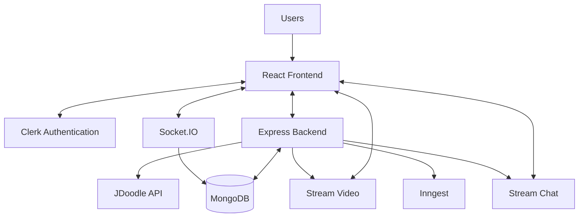
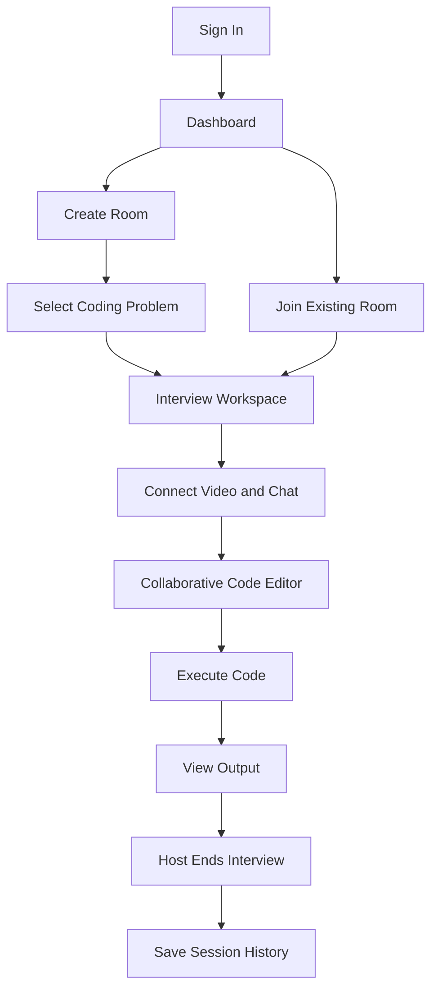

# CodeBooth

**A Collaborative Mock Interview Platform for Developers**

CodeBooth is a browser-based mock interview platform for solo coding practice and 1-on-1 technical interviews. It combines coding problems, a collaborative code editor, code execution, video calling, and real-time chat in one workspace.

## Features

- **Interview Rooms** – Create and join collaborative coding sessions.
- **Real-Time Code Collaboration** – Synchronize code changes using Socket.IO.
- **Video Interviews** – Conduct mock interviews using Stream Video.
- **Live Chat** – Communicate through Stream Chat.
- **Code Execution** – Execute JavaScript, Python, and C++ using JDoodle.
- **Problem Library** – Explore 100 DSA problems with search and difficulty filters.
- **Solo Practice** – Solve problems independently in an integrated coding workspace.
- **Session History** – View completed interview sessions.

## Tech Stack

| Category | Technologies |
|---|---|
| Frontend | React 19, Vite, Tailwind CSS, DaisyUI |
| Backend | Node.js, Express.js |
| Database | MongoDB, Mongoose |
| Authentication | Clerk |
| Real-Time Communication | Socket.IO |
| Video & Chat | Stream Video, Stream Chat |
| Code Editor | Monaco Editor |
| Code Execution | JDoodle API |
| Data Fetching | TanStack Query, Axios |
| Background Events | Inngest |

## Architecture



## Interview Workflow



## Getting Started

### Prerequisites

- Node.js
- MongoDB
- Clerk account
- Stream account
- JDoodle API credentials

### 1. Clone the repository

```bash
git clone https://github.com/advitya4169/codebooth.git
cd Codebooth
```

### 2. Configure environment variables

Create `.env` files inside the `backend` and `frontend` directories.

**Backend — `backend/.env`**

```env
PORT=5000
DB_URL=your_mongodb_connection_string
CLIENT_URL=http://localhost:5173

CLERK_SECRET_KEY=your_clerk_secret_key

STREAM_API_KEY=your_stream_api_key
STREAM_API_SECRET=your_stream_api_secret

JDOODLE_CLIENT_ID=your_jdoodle_client_id
JDOODLE_CLIENT_SECRET=your_jdoodle_client_secret

INNGEST_EVENT_KEY=your_inngest_event_key
INNGEST_SIGNING_KEY=your_inngest_signing_key
```

**Frontend — `frontend/.env`**

```env
VITE_CLERK_PUBLISHABLE_KEY=your_clerk_publishable_key
VITE_API_URL=http://localhost:5000
VITE_SOCKET_URL=http://localhost:5000
VITE_STREAM_API_KEY=your_stream_api_key
```

### 3. Start the backend

```bash
cd backend
npm install
npm run dev
```

### 4. Start the frontend

Open another terminal:

```bash
cd frontend
npm install
npm run dev
```

Open `http://localhost:5173` to access CodeBooth.

## Project Structure

```text
CodeBooth/
├── frontend/
│   └── src/
│       ├── Components/
│       ├── Pages/
│       ├── Data/
│       ├── api/
│       ├── hooks/
│       └── lib/
│
├── backend/
│   └── src/
│       ├── controllers/
│       ├── middleware/
│       ├── models/
│       ├── routes/
│       ├── lib/
│       └── server.js
│
└── README.md
```

---

**Built to make technical interview practice more collaborative and accessible.**
